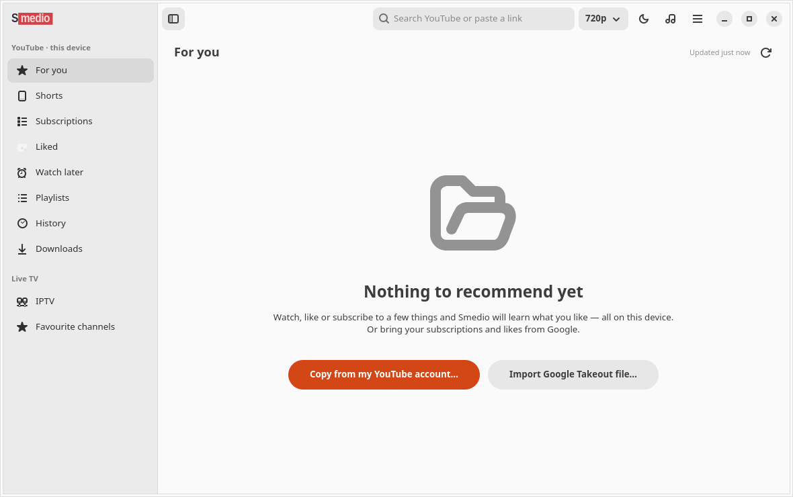
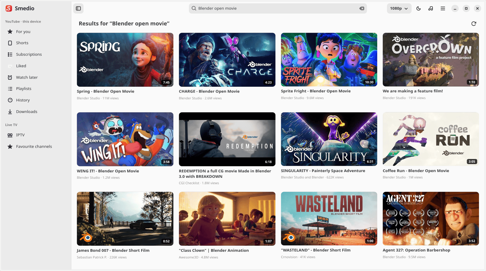

# Smedio

**Your GPU decodes, your CPU rests.** Smooth YouTube and live TV even on a
10-year-old laptop: Smedio checks what your GPU can decode (VA-API, V4L2) and
picks AV1, VP9 or H.264 to match. Ad-free, no account, no Electron.

One lightweight Linux app for low-end laptops and ARM tablets. It plays only
formats your hardware decodes, so video stays smooth on machines where a
browser stutters.





## Features

- **YouTube without ads**: search, channels, playlists, Shorts, comments,
  related videos, a "next up" queue, and previews when you hover over a
  thumbnail.
- **Your own library, on your device**: subscriptions, likes, Watch later,
  playlists and history live in a local SQLite file, and "For you"
  recommendations are computed locally. No account is needed.
- **Or your Google account, read-only**: Smedio can show your real YouTube
  home, subscriptions, likes and playlists using the login of a browser you're
  already signed in to. It never writes anything to your account, and it can
  copy everything into the local library once. You can also import a Google
  Takeout file.
- **Live TV**: every country and region from
  [iptv-org](https://github.com/iptv-org/iptv), plus any M3U playlist (link
  or file) you add. It has favourites and channel search, tries a channel's
  backup sources when one fails, and hides dead channels.
- **Downloads**: video (H.264 in MP4 by default, or best quality in any codec) or audio
  only (M4A).
- **One built-in player**: an embedded mpv, with a mini player while you
  browse, fullscreen, speed, "stats for nerds", and quality from 360p to
  1080p. An audio-only mode saves data.

## Hardware decoding

Smedio asks YouTube for formats the hardware can decode, and mpv decodes them
on the GPU or video engine:

| Hardware | Decoder | Formats YouTube is asked for |
|---|---|---|
| Intel / AMD PCs | VA-API | H.264 (older GPUs such as Intel HD 520 decode nothing else YouTube sends) |
| ARM boards and tablets with a V4L2 video decoder (e.g. Qualcomm Venus) | V4L2 mem2mem (`v4l2m2m-copy`) | VP9 where the decoder supports it, else H.264 |

Smedio reads which formats the V4L2 decoders support from the kernel at
start-up. "Stats for nerds" (key `I`) shows which decoder is in use.

Tested on:
- a Dell laptop with Intel HD 520 (VA-API, H.264);
- a Samsung Galaxy Tab S3 (Snapdragon 820) running
  [mainline Linux](https://github.com/wh1ter0z3/gts3lwifi-mainline) on
  postmarketOS: YouTube VP9 1080p decodes on the Venus video engine at about
  1.4 CPU load.

## Install

Smedio is a single Python file. The installer puts it in your home folder; no
root is needed.

```sh
git clone https://github.com/wh1ter0z3/smedio
cd smedio
./install.sh
```

You need Python 3.10 or newer with GTK 4, libadwaita 1.6 or newer, and libmpv.
If one of them is missing, the installer says so and prints the command for
your distribution:

| Distribution | Packages |
|---|---|
| postmarketOS, Alpine | `sudo apk add py3-gobject3 gtk4.0 libadwaita mpv py3-mpv yt-dlp ffmpeg` |
| Debian 13, Ubuntu 25.04 and newer | `sudo apt install python3-gi gir1.2-gtk-4.0 gir1.2-adw-1 libmpv2 python3-venv ffmpeg` |
| Fedora | `sudo dnf install python3-gobject gtk4 libadwaita mpv-libs ffmpeg` |
| Arch | `sudo pacman -S python-gobject gtk4 libadwaita mpv python-mpv yt-dlp deno ffmpeg` |

Ubuntu 24.04's libadwaita (1.5) is too old.

**About yt-dlp:** YouTube changes often, and yt-dlp follows within days. If
your distribution's yt-dlp is less than 4 months old, Smedio uses it. If it's
older or missing, the installer gives Smedio its own up-to-date copy in a
private folder (with Deno, the JavaScript runtime yt-dlp needs for YouTube,
when the system has none). Menu → Update yt-dlp keeps that copy current. To
choose yourself:

```sh
./install.sh --venv     # always the private copy
./install.sh --system   # always the distribution's yt-dlp and python-mpv
```

ffmpeg is only needed for downloads.

Run `./install.sh` again to update. To remove Smedio (your library and
settings stay):

```sh
./install.sh --uninstall
```

### postmarketOS package

[packaging/postmarketos/APKBUILD](packaging/postmarketos/APKBUILD) builds the
latest tagged release as an Alpine package (it installs to `/usr/share/smedio`,
for every user). On the device, with `abuild` set up:

```sh
cd packaging/postmarketos
abuild -r
```

Or with pmbootstrap, copy the folder into your pmaports checkout (for example
as `temp/smedio`) and run `pmbootstrap build smedio`.

## Keyboard

| Key | Action |
|---|---|
| `Ctrl+L`, `Ctrl+F` | search |
| `Space`, `K` | play / pause |
| `←` `→` | back / forward 5 s |
| `J` `L` | back / forward 10 s |
| `↑` `↓` | volume |
| `M` | mute |
| `F`, `Esc` | fullscreen / leave fullscreen |
| `N` | next video (next channel on live TV) |
| `Page Up` `Page Down` | previous / next channel |
| `Z` `X` | subtitles earlier / later |
| `I` | stats for nerds |
| `Ctrl+,` | preferences |
| `Ctrl+Q` | quit |

## Your data

Everything stays on your device:

| What | Where |
|---|---|
| Library | `~/.local/share/smedio-library/library.db` (Preferences can export it as a JSON backup and import it again) |
| Settings | `~/.config/smedio/config.json` |
| Thumbnails and page cache | `~/.cache/smedio` |

With a Google account selected, Smedio reads that browser's YouTube cookies
to fetch your feeds. It only reads, and it shows a note that using an account
with third-party tools carries a small risk of YouTube flagging it.

## License

MIT; see [LICENSE](LICENSE). Smedio stands on
[yt-dlp](https://github.com/yt-dlp/yt-dlp), [mpv](https://mpv.io),
[python-mpv](https://github.com/jaseg/python-mpv), GTK and libadwaita, and
uses [iptv-org](https://github.com/iptv-org/iptv)'s public channel lists.
It is not affiliated with YouTube or Google.
